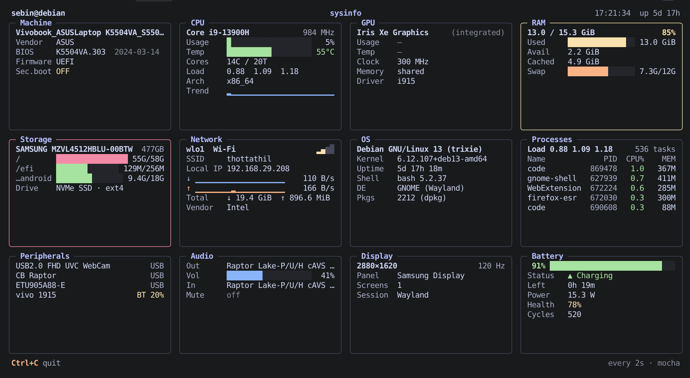

# sysinfo

**Everything about your machine, on one screen.**
A live, tile-based system dashboard for the Linux terminal. No root, no config, no fuss.

<!-- Add a screenshot: save it as screenshot.png next to this file.
     Tip: blur your local IP and hostname before publishing. -->


`sysinfo` is the dashboard you wish `neofetch` had: it doesn't just print your specs once and exit, it keeps watching. CPU, memory, disks, network, GPU, battery, audio, displays and the busiest processes all update live in a tidy grid of tiles that reflows to fit your terminal.

## Highlights

- **One glance, whole machine.** Twelve tiles cover hardware, OS, and live activity.
- **Live graphs.** CPU history and network throughput are drawn as sparklines.
- **Early warnings.** Tile borders turn yellow or red when something needs attention: a nearly full disk, hot CPU, memory pressure, low battery.
- **Adapts to your screen.** One to four columns depending on terminal width, and it trims low-priority lines when space is tight.
- **Hides what doesn't apply.** No battery on a desktop? No battery tile.
- **Gentle on the system.** Slow lookups (GPU, audio, Bluetooth, packages) run in a background thread so the display never stalls.
- **Pretty by default.** Three built-in colour themes: `mocha`, `tokyo` and `nord`.
- **Script-friendly.** `--once` (or piping the output) prints a single snapshot and exits.

## What it shows

| Tile | Contents |
|---|---|
| **Machine** | Model, vendor, BIOS version and date, UEFI/BIOS, Secure Boot, VM detection |
| **CPU** | Model, frequency, usage bar, temperature, cores/threads, load average, history graph |
| **GPU** | Name, type, usage, temperature, clock, VRAM, driver (NVIDIA, AMD and Intel) |
| **RAM** | Used / available / cached, swap usage |
| **Storage** | Drive model, size and type (NVMe SSD / SSD / HDD), per-mount usage bars |
| **Network** | Active interface, Wi-Fi signal and SSID, IP, live up/down graphs, totals, NIC vendor |
| **OS** | Distro, kernel, uptime, shell, desktop environment, package count |
| **Processes** | Task count and the top processes by CPU, with memory use |
| **Peripherals** | Connected USB devices and Bluetooth devices with battery levels |
| **Audio** | Default output and input, volume, mute state (PipeWire or PulseAudio) |
| **Display** | Resolution, refresh rate, panel make/model from EDID, session type |
| **Battery** | Charge, status, time remaining, power draw, health and cycle count |

## Install

```bash
git clone https://github.com/novaspot/sysinfo.git
cd sysinfo
bash install.sh
```

The installer checks your Python version, works out your distro, and installs the two dependencies (`rich` and `psutil`) the best way available:

1. uses them if they're already installed;
2. otherwise offers to install your distro's packages (showing the exact command first);
3. otherwise falls back to a private virtualenv, no root needed.

It then puts a `sysinfo` command in `~/.local/bin` and, if that folder isn't on your `PATH`, offers to add it to your shell config. Open a new terminal afterwards and run `sysinfo`.

Installer options:

| Option | Effect |
|---|---|
| `--venv` | Always use a private virtualenv |
| `--native` | Only use distro packages |
| `-y` | Don't ask before running the package manager or editing shell config |
| `--uninstall` | Remove the launcher and installed files |

### Manual install

```bash
# Debian / Ubuntu
sudo apt install python3-rich python3-psutil
# or anywhere, in a virtualenv
python3 -m venv .venv && . .venv/bin/activate && pip install rich psutil

python3 sysinfo.py
```

## Usage

```
sysinfo                     live dashboard, refreshes every 2 seconds (Ctrl+C to quit)
sysinfo --once              print one snapshot and exit
sysinfo -i 1                refresh every second (minimum 0.5)
sysinfo --theme tokyo       pick a theme: mocha (default), tokyo, nord
sysinfo --public-ip         also look up your public IP (off by default)
```

When its output isn't a terminal (for example `sysinfo > snapshot.txt`), it prints a single snapshot instead of running live.

## Requirements

- Linux with Python 3.7 or newer
- [`rich`](https://github.com/Textualize/rich) and [`psutil`](https://github.com/giampaolo/psutil)
- A terminal with truecolor and Unicode support for the best look (most modern terminals qualify)

Optional helpers give richer detail when present, and every tile degrades gracefully without them:
`lspci` (GPU and NIC names), `pactl` or `wpctl` (audio), `bluetoothctl` (Bluetooth), `nmcli` or `iwgetid` (Wi-Fi SSID), `xrandr` (refresh rate on X11), `nvidia-smi` (NVIDIA GPUs), `lsblk` (drive details).

## Privacy and safety

- **Read-only.** It reads from `/proc`, `/sys` and a handful of standard tools. It changes nothing on your system.
- **No root needed.**
- **Offline by default.** The only network request it can make is the public IP lookup (via `api.ipify.org`), and only if you pass `--public-ip`.

## Compatibility

Developed and tested on **Debian 13 (trixie)** with GNOME on Wayland. Other mainstream distros should work, but hardware varies a lot. Some things to know:

- **Intel integrated GPUs** don't expose utilisation or temperature through standard interfaces, so those rows show `–`.
- **Raspberry Pi and other ARM boards** have no BIOS/DMI data, so the Machine tile is sparse.
- **Headless servers** have no display, audio or peripherals; those tiles simply report nothing found.
- **Containers** report the host's uptime and CPU count rather than your cgroup limits.

If something looks wrong on your hardware, please open an issue.

## Troubleshooting

| Problem | Fix |
|---|---|
| `sysinfo: command not found` | Open a new terminal, or add `~/.local/bin` to your `PATH` |
| Colours look washed out | Use a truecolor terminal, or try another `--theme` |
| Tiles are cut off | Make the terminal taller or wider; it drops lines to fit |
| A row shows `–` | The data isn't exposed on your hardware, or an optional helper isn't installed |
| `Missing dependencies` on start | Re-run `bash install.sh` |

## Uninstall

```bash
bash install.sh --uninstall
```

This removes the launcher and installed files. System packages (`python3-rich`, `python3-psutil`) are left alone, and any `PATH` line added to your shell config stays; it's harmless.

## Contributing

Bug reports and pull requests are welcome. When reporting a problem, please include your distro, terminal, and the output of `sysinfo --once`.

## License

MIT. See `LICENSE`. (Add a `LICENSE` file before publishing.)